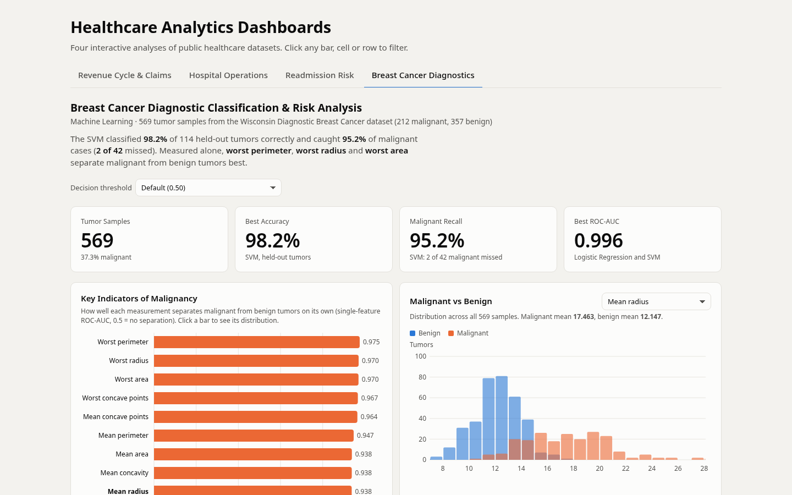
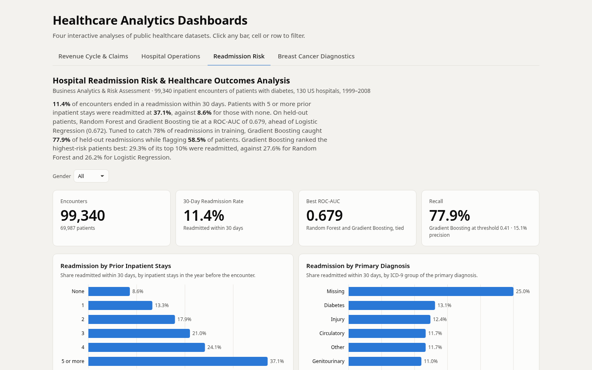
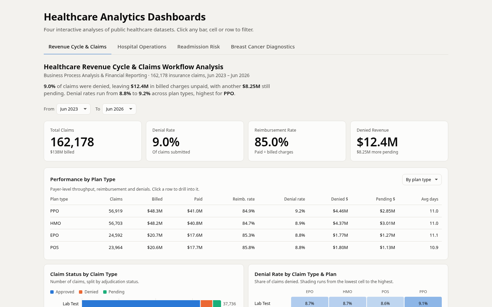
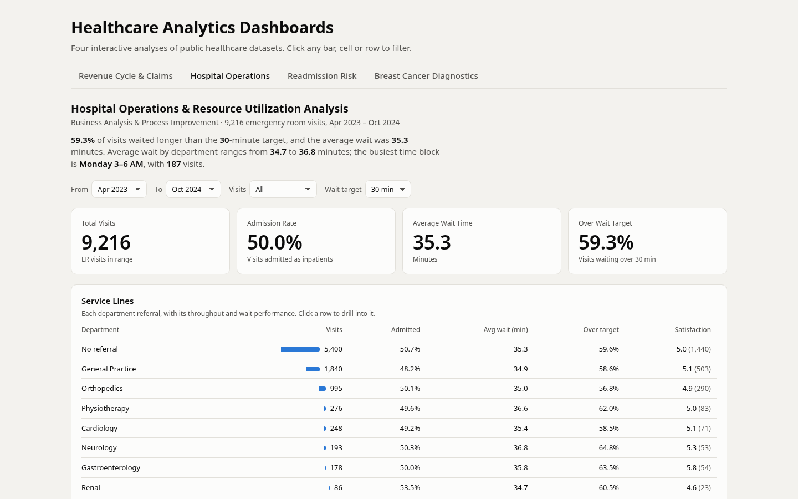

# Breast Cancer Diagnostic Classification & Risk Analysis

Interactive **healthcare analytics portfolio project** featuring a breast cancer diagnostic classification analysis and three additional healthcare dashboards. Built as a self-contained website using **HTML, CSS, JavaScript, and D3.js**.

## Interactive Dashboard

**[Open the Breast Cancer Dashboard](https://urmillachowdary-bit.github.io/Breast-Cancer-Diagnostic-Classification-and-Risk-Analysis/#breast-cancer)**

*The website link will work after GitHub Pages is enabled on this repository.*

## Dashboard Previews

### 1. Breast Cancer Diagnostic Classification & Risk Analysis



### 2. Hospital Readmission Risk & Healthcare Outcomes Analysis



### 3. Healthcare Revenue Cycle & Claims Analysis



### 4. Hospital Operations & Resource Utilization Analysis



> The PNG screenshots show the top portion of each dashboard. Use the live website for the interactive charts, filters, and full analysis.

## About the Project

### Breast Cancer Diagnostic Classification

This analysis explores differences between **malignant and benign tumor measurements** from the Wisconsin Diagnostic Breast Cancer dataset, and compares machine-learning model predictions on held-out tumor samples.

- **569 tumor samples** in total: **212 malignant** and **357 benign**.
- **114 held-out samples** for model evaluation, including **42 malignant** cases.
- The **SVM** reached **98.2% test accuracy**, correctly classifying 112 of 114 held-out samples.
- **Malignant recall: 95.2%** for SVM at the displayed default threshold (40 of 42 malignant tumors correctly identified; 2 missed).
- **Best reported ROC-AUC: 0.996** (Logistic Regression and SVM).
- Compares **Logistic Regression, Random Forest, SVM, and KNN** and provides performance tables, ROC curves, confusion matrices, feature distributions, and a choice of decision threshold.
- The page describes an **80/20 stratified split** and cross-validation-based model and feature selection. The original training scripts are *not* included in this repository.

**Interpretation:** High performance on this benchmark does not establish diagnostic readiness or clinical safety. Recall is especially relevant when considering missed malignant cases.

### Other Healthcare Analytics Dashboards

| Analysis | Data covered | Dashboard-reported results |
| --- | --- | --- |
| Hospital Readmission Risk | 99,340 inpatient encounters involving patients with diabetes | 11.4% readmitted within 30 days; best test ROC-AUC **0.679**; Gradient Boosting recall **77.9%** at its displayed operating point |
| Revenue Cycle & Claims | 162,178 synthetic insurance claims; 12,845-record synthetic claims audit sample | **9.0%** denial rate; **85.0%** reimbursement rate |
| Hospital Operations | 9,216 synthetic emergency room visits | **50.0%** admission rate; **35.3-minute** average wait; **59.3%** above the default 30-minute target |

These are results reported by the supplied dashboard and embedded model outputs, not externally verified performance claims. Filters and thresholds may change displayed metrics. The 30-minute ER threshold is an analysis setting, not an established hospital service-level requirement.

## Features

- Four dashboard tabs with responsive layouts.
- Interactive KPI cards, charts, comparison tables, filters, and drill-downs.
- Breast cancer tumor measurement distributions, diagnostic feature comparisons, ROC curves, and confusion matrices.
- Model comparisons and threshold selection for the breast cancer and readmission analyses.
- Insurance claims reconciliation, denial trends, and synthetic claims audit checks.
- ER arrival trends, departmental referrals, wait-time distributions, and an adjustable wait target.

## Technologies

- **Frontend:** HTML5, CSS3, JavaScript
- **Charts:** D3.js and SVG
- **Documented machine learning:** scikit-learn model outputs and evaluation methods described in the page
- **Analytical concepts:** KPI reporting, classification performance, readmission risk, claims analytics, ER throughput
- **Hosting:** GitHub Pages (static site)

The complete dashboard uses embedded data, prepared predictions, and bundled JavaScript. It is **not** a native Power BI or Tableau workbook. Source Python notebooks, executable model-training scripts, and independent SQL assets are not part of this package; SQL/DAX examples displayed in the page are explanatory.

## Run Locally

1. Download `index.html` from this repository.
2. Open it in Chrome, Edge, or Firefox.
3. Switch among the four tabs and explore the interactive graphics.

No server, software installation, database connection, or build process is needed.

## Publish with GitHub Pages

1. Upload the files in this repository **at the top level**. Do not upload the ZIP without extracting it.
2. Go to **Settings → Pages**.
3. Choose **Deploy from a branch**, then `main` and `/(root)`.
4. Click **Save**. After GitHub reports a successful deployment, open the dashboard link above.

The `index.html` file must be in the repository root. The screenshots are also placed in the root, so README image paths like `` work without a `screenshots/` folder.

## Repository Structure

```text
Breast-Cancer-Diagnostic-Classification-and-Risk-Analysis/
├── index.html
├── README.md
├── breast-cancer.png
├── readmission.png
├── claims.png
└── hospital-operations.png
```

## Data Sources & Attribution

- **Breast cancer:** Wisconsin Diagnostic Breast Cancer (WDBC) dataset, University of Wisconsin / UCI Machine Learning Repository; also distributed with scikit-learn.
- **Readmissions:** UCI *Diabetes 130-US Hospitals for Years 1999–2008*, Strack and colleagues (2014), de-identified inpatient encounters.
- **Emergency room:** `Hospital ER_Data.csv`, described by the dashboard as a synthetic 9,216-visit dataset.
- **Claims:** Synthetic insurance claims attributed within the dashboard to `insurance-claims-dashboard` by `nourhan-ali-ml`.
- **Claims audit:** Synthetic adjudicated claims attributed within the dashboard to `Healthcare_claim_cost_analysis1` by `shubhamdataanalytic5`.
- **Charting:** Embedded D3.js library, with its original copyright notice retained.

**Check the license terms** for embedded datasets and third-party code before publicly distributing this repository. Public accessibility does not automatically grant redistribution permission, and patient-identifiable data must not be published.

## Limitations

- Educational demonstration only; **not a medical diagnosis or treatment tool**.
- Model metrics are dataset- and evaluation-specific; original training scripts are not included and cannot be independently rerun from this repository.
- This project provides a standalone interactive web dashboard, not native Power BI or Tableau files.
- Some datasets are synthetic, and reported values may change as filters and model decision thresholds change.

## Portfolio Relevance

Illustrates skills relevant to **Data Analyst, Business Analyst, BI Analyst, and Healthcare Data Analyst** roles through data interpretation, interactive dashboard development, classification model evaluation, and KPI reporting.
